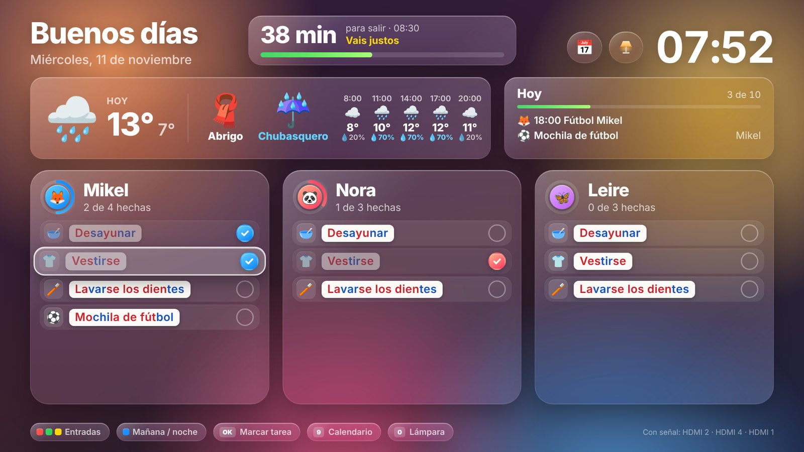
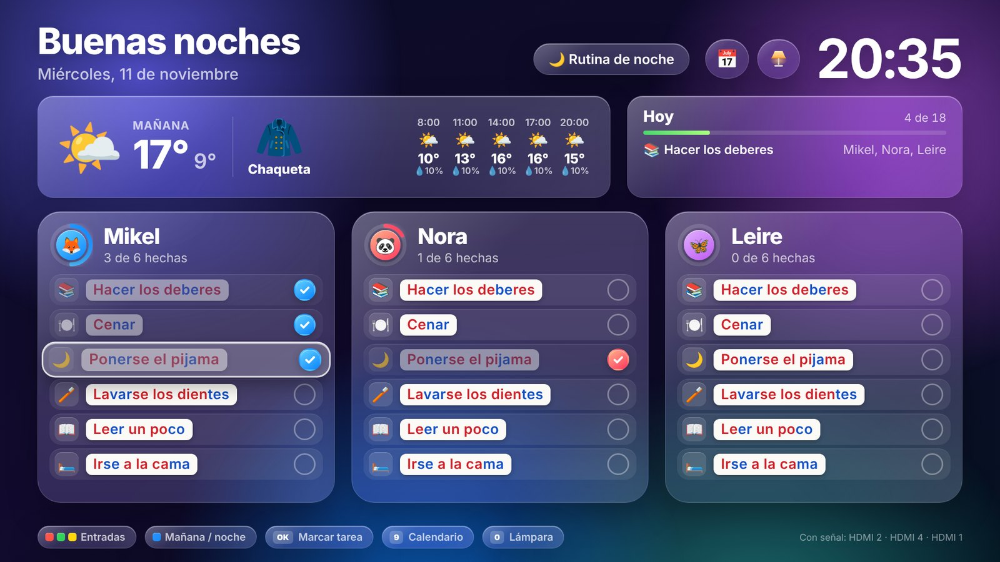
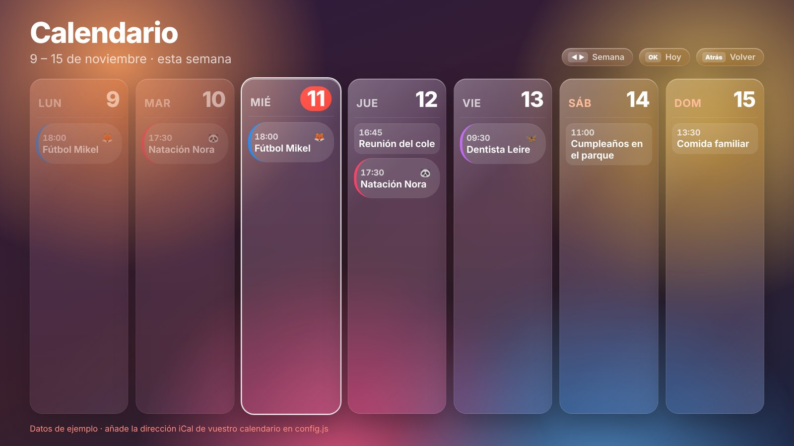
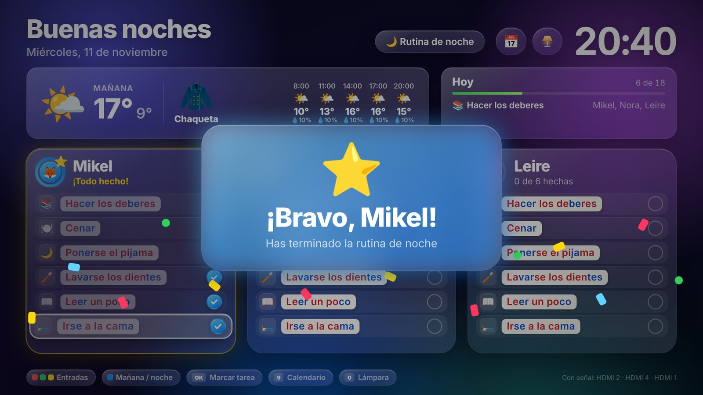
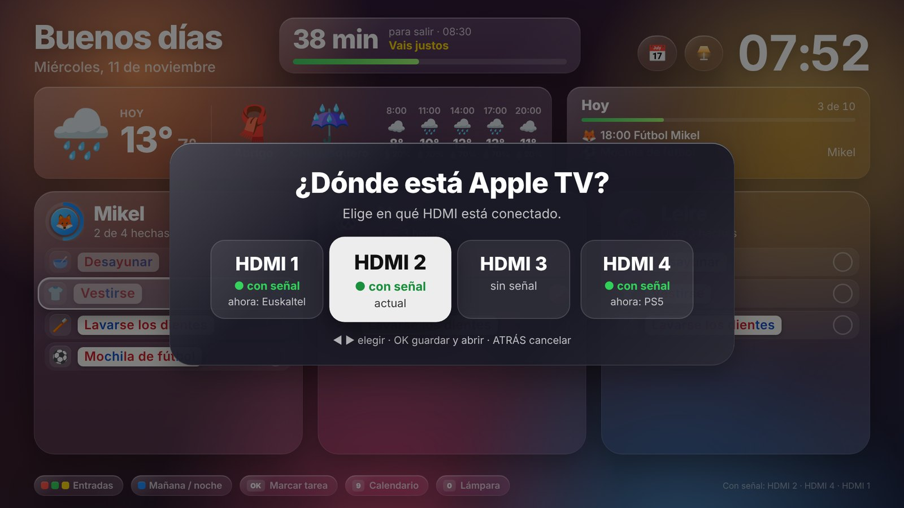
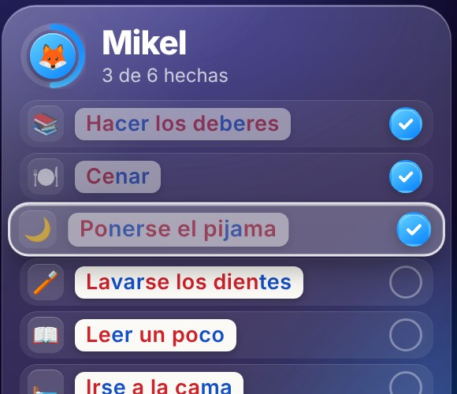

# Casa TV

**A family dashboard for Samsung Tizen TVs.** It turns the living-room TV into a morning-and-evening routine board for the kids, with a leave-the-house countdown, a weather card that says what to wear, the family calendar and a warm reading lamp. Your Apple TV, console and set-top box stay one button away on the remote.



> The interface is in Spanish because that is the language of the house. Strings live in the JS and CSS files; there is no i18n layer yet.

---

## Contents

- [Features](#features)
- [Screenshots](#screenshots)
- [Getting started (in a browser)](#getting-started-in-a-browser)
- [Install on a Samsung TV](#install-on-a-samsung-tv)
- [Configuration](#configuration)
- [Remote control](#remote-control)
- [How it works](#how-it-works)
- [Limitations](#limitations)
- [Credits](#credits)
- [License](#license)

## Features

**Routines for the kids**
- One column per kid, each with an emoji avatar and a progress ring. Tick tasks with **OK**.
- The board switches from the morning routine to the evening one at a set time (14:00 by default). The **blue** button switches it by hand.
- Tasks can be limited to certain weekdays, certain kids or a date range, such as *football bag on Tuesdays and Thursdays* or *school swimming until 18 December*.
- Ticks are saved on the TV and reset every day. A celebration pops up when a kid finishes their list.
- **Reading support.** Labels can be split into syllables in alternating red and blue, as recommended for children learning to read; this uses a Spanish syllabifier written for the app. There is also an optional *one order at a time* mode that shows only the current task, in big type, as an imperative.

**Leave-the-house countdown**
- From a start time (say, when the kids get up) until you have to leave, a bar counts down the minutes. It tells you whether you are on time, cutting it close or late.
- It plays soft chimes at 10 and 5 minutes before leaving, at leaving time and at the hard limit.

**Weather that says what to wear**
- Shows today's forecast in the morning and tomorrow's in the evening, so the clothes can be laid out the night before.
- Picks a garment (scarf and coat, jacket, sweatshirt or T-shirt) from the temperature at the time you leave home.
- Adds ☔ *raincoat* when the chance of rain between 7:00 and 20:00 is high, and shows an hourly strip for 8, 11, 14, 17 and 20 h.
- Data comes from [Open-Meteo](https://open-meteo.com), which needs no API key.

**Family calendar**
- A week view built from iCal feeds, such as an iCloud public calendar (`webcal://` links work) or Google Calendar.
- Events with a kid's name in the title get that kid's avatar and colour. Public holidays are highlighted.
- Today's upcoming events also appear in the **Today** card on the dashboard.

**Lamp mode**
- Turns the screen into a dim, warm light for reading on the sofa, from 1800 K to 3500 K.
- The light can fill the screen or be a halo with a dark centre. It has a sleep timer and keeps the screensaver away.

**Input switching**
- Switch to the Apple TV, console or set-top box with the coloured buttons or 1-2-3.
- If an input has no signal, a picker shows which HDMI ports are live, so you can fix the mapping from the sofa. The **8** key opens it at any time.
- Optional SmartThings mode, which switches the TV's real input instead of showing it inside the app.

**Built for the TV**
- The layout is drawn at 1920×1080 and scaled to the screen.
- The "liquid glass" look has a *lite* mode that is used automatically on the TV, so a modest TV GPU can keep up.
- Press **7** for an on-screen FPS meter.

## Screenshots

| | |
|---|---|
|  |  |
| **Evening.** The weather card shows tomorrow. | **Calendar.** Week view from iCal feeds. |
|  |  |
| **Done!** A celebration when a kid finishes. | **HDMI picker.** Live ports are marked. |
|  |  |
| **Lamp mode.** Warm halo for reading. | **Syllables** in alternating colours. |

*All screenshots use the example configuration: made-up kids, demo calendar and simulated weather.*

## Getting started (in a browser)

You can try everything on your computer before touching the TV.

```sh
git clone <this repo> casa-tv
cd casa-tv
cp js/config.local.example.js js/config.local.js   # your private settings (git-ignored)
python3 -m http.server 8000
```

Open <http://localhost:8000> in Chrome with the window at 1920×1080, or let it scale. The keyboard stands in for the remote:

| Keyboard | Remote |
|---|---|
| Arrow keys, Enter | D-pad, OK |
| Esc / Backspace | Back |
| R · G · Y · B | Red · Green · Yellow · Blue |
| 0 · 7 · 8 · 9 | Lamp · FPS meter · HDMI picker · Calendar |

In the browser, inputs show a *preview* instead of real HDMI video, and all ports appear connected. The weather loads for real. iCal feeds may be blocked by CORS in a desktop browser; on the TV they are not, because `config.xml` allows those origins.

## Install on a Samsung TV

Sideloading uses Samsung's developer mode and a free Samsung certificate tied to your TV. You need a Samsung account, the computer and the TV on the same network, and about 20 minutes the first time.

### 1. Tools

Install **VS Code** and the **Tizen TV** extension (publisher `samsungtvsdk`); it pulls in the base Tizen extension. In the Tizen sidebar, open *Package Manager* and install the latest **TV** extension, for example "10.0 TV". Tizen Studio with its Certificate Manager works too.

### 2. Developer mode on the TV

1. Open **Apps** on the TV and type `1` `2` `3` `4` `5` with the remote.
2. Turn **Developer mode** on and enter your **computer's IP address**.
3. **Cold-reboot the TV.** Hold the remote's power button until the Samsung logo appears. A normal off/on is not enough: until you do this, the TV refuses connections on port 26101.

> Give your computer a fixed IP (a DHCP reservation in your router). If it changes, the TV stops accepting connections until you update developer mode.

### 3. Connect the TV

In the Tizen extension, go to **Connect Device → Remote Devices → + Create Custom Connection**. Enter the TV's IP and port **`26101`**, then select it and press **Connect**.

### 4. Create a Samsung certificate

With the TV connected, go to **Create Certificate** and choose a profile name.

1. Choose **Create Samsung Certificate** and fill in the author details (keep the password).
2. Under **Distributor details**, set the privilege level to **Public** and tick your TV's **DUID**, its *unique device ID*.
3. Press **Create** and sign in with your Samsung account when asked.

The certificate only works on the TVs whose DUIDs it contains.

### 5. Build and run

1. Open the project folder in VS Code.
2. Make sure `js/config.local.js` exists. The package manifest (`tizen_web_project.yaml`) lists it, so copy the example if you haven't.
3. Press **Run Project**. The app installs, launches and appears in the TV's app list.

Use **Run**, not *Debug*: the debugger slows the app down noticeably.

From the terminal (Tizen Studio):

```sh
./tools/build-and-install.sh <TV_IP> <certificate_profile>
```

### Troubleshooting

| Symptom | Fix |
|---|---|
| `Connection refused` on 26101 | Developer mode is off, has a stale host IP, or the TV hasn't been cold-rebooted. |
| Error **1010** when installing | Wrong certificate: it must be a *Samsung* certificate (not *Tizen*) and include this TV's DUID. |
| Error **1013** when launching | Try again, or reboot the TV. |
| *Working project is not set* | Pick the project as the active target in the Tizen extension. |
| The launcher keeps showing an old icon | Uninstall the app from the TV, cold-reboot, and install again. |
| Images missing or layout broken on the TV | The TV's browser engine is older than desktop Chrome. Test there, not only in the browser. |

## Configuration

There are two files:

- **`js/config.js`** is public and holds the defaults. It contains example kids, a sample location and generic routines.
- **`js/config.local.js`** is private and git-ignored. It is loaded right after `config.js` and overrides whatever it needs: your kids, your calendar link, your home location and any SmartThings credentials. Start from `js/config.local.example.js`.

```js
// js/config.local.js
(function (c) {
  c.calendar.feeds.unshift({ name: 'Family', url: 'webcal://pXX-caldav.icloud.com/published/2/…' });
  c.weather.lat = 43.26; c.weather.lon = -2.93;
  c.kids = [
    { id: 'mikel', name: 'Mikel', avatar: '🦊', gradient: ['#64d2ff', '#0a84ff'], syllables: true }
  ];
  c.routines.morning.push(
    { id: 'football', label: 'Mochila de fútbol', order: 'Prepara la mochila', icon: '⚽', days: [2, 4], kids: ['mikel'] }
  );
})(window.APP_CONFIG);
```

| Key | What it does |
|---|---|
| `sources[]` | Inputs: `name`, `hdmi` port, `via` (`'tvwindow'` or `'smartthings'`), artwork, colour key. |
| `ui.sourcesOnBoard` | `false` (default) hides the input buttons and gives their space to the weather card. |
| `ui.performance` | `'auto'` (lite on the TV, full in the browser), `'lite'` or `'full'`. |
| `ui.transparency`, `ui.motion` | Glass opacity and background animation. |
| `kids[]` | `id`, `name`, `avatar`, `gradient`, `syllables` (`true` or `'continuous'`), `focusMode`. |
| `routines.morning` / `evening` | Tasks: `label`, `order` (imperative), `icon`, and optional `days` (0 = Sunday), `kids`, `from` and `until` (`YYYY-MM-DD`). |
| `morningUntil` | The time the board switches from morning to evening. |
| `departure` | Countdown: `days`, `start`, `readyBy`, `leave`, `limit`, `sound`. |
| `weather` | `lat`, `lon`, `rainFrom` (%), `hours`, and `clothes` thresholds (`upTo` °C). |
| `calendar.feeds[]` | iCal URLs; `holidays: true` highlights a feed's days. |
| `smartthings` | OAuth client and device ID for real input switching (see `tools/smartthings-oauth.mjs`). |

**About the calendar link.** An iCloud or Google *public/secret* iCal link gives read access to anyone who has it. Keep it in `config.local.js`, never in `config.js`.

## Remote control

| Button | Action |
|---|---|
| ◀ ▶ ▲ ▼ · OK | Move · tick a task / open |
| 🔴 🟢 🟡 or 1 · 2 · 3 | Switch to input 1 · 2 · 3 |
| 🔵 | Morning ⇄ evening routine |
| 8 | HDMI picker (reassign ports) |
| 9 | Week calendar (◀ ▶ change week, OK this week) |
| 0 | Lamp mode (▲▼ brightness, ◀▶ warmth, OK shape, 🟡 sleep timer) |
| 7 | FPS meter |
| Back | Close the overlay / stop watching an input / exit |

## How it works

```
index.html            1920×1080 stage, scaled to the screen
config.xml            Tizen manifest: privileges (tv.window, tv.inputdevice, internet) and allowed origins
tizen_web_project.yaml  files that go into the .wgt package
css/style.css         liquid-glass UI, lite mode, all layouts
js/config.js          public defaults · js/config.local.js private overrides
js/app.js             rendering, remote keys, focus, toasts, HDMI picker
js/nav.js             spatial navigation by geometry (no focus map to maintain)
js/routines.js        which tasks apply today, ticks persisted per day in localStorage
js/syllables.js       Spanish syllabifier for the red/blue labels
js/departure.js       countdown phases, pace and Web Audio chimes
js/weather.js         Open-Meteo client, clothing rules, offline cache
js/calendar.js        iCal parser (RRULE, EXDATE, RECURRENCE-ID), feeds, cache
js/calview.js         week view
js/lamp.js            Kelvin → RGB light, halo, sleep timer, screensaver control
js/sources.js         input switching: TV Window API or SmartThings, HDMI discovery
tools/                CLI install script, SmartThings OAuth helper, Blender render scripts
```

Some design decisions:

- **ES5, no build step.** Older Tizen TVs ship an old Chromium. Plain scripts run anywhere and are easy to debug on the TV.
- **Two ways to switch inputs.**
  - The Tizen **TV Window** API shows the HDMI signal inside the app. It is instant and needs no account, but the TV does not change its real input, so the device is not woken through HDMI-CEC.
  - **SmartThings** changes the TV's real input, which keeps Game Mode, VRR and 120 Hz for a console. The cost is an OAuth app and a cloud round-trip.
- **Lite mode.** Animated backgrounds behind `backdrop-filter` force the blur to be recomputed every frame, and a TV GPU can't keep up. Lite mode stops the background and keeps blur only on the large panels. In a GPU-less browser that took the app from about 12 fps to 60 fps.
- **Private data stays out of git.** Names, calendar links and locations live only in `config.local.js`.

## Limitations

- **Tested on one TV:** a 2024 Samsung QN85D. The manifest targets Tizen 3.0+ and the code avoids newer JS, but older models are untested.
- **Inputs can't be powered on.** In TV Window mode the app shows the input but does not wake the device. A console in rest mode reports no signal.
- **Spanish only.** The UI strings and the syllabifier are Spanish.
- **Developer-mode install only.** This isn't a Samsung Store app, and each TV needs its DUID in your certificate.

## Credits

- [Inter](https://rsms.me/inter/) typeface by Rasmus Andersson, SIL Open Font License (see `fonts/OFL-Inter.txt`).
- Weather data by [Open-Meteo.com](https://open-meteo.com) (CC BY 4.0).
- Apple TV, PlayStation, Samsung, SmartThings and Tizen are trademarks of their respective owners. This project is not affiliated with or endorsed by any of them.

## License

[MIT](LICENSE) © 2026 Iván Ornes. The Inter font keeps its own license (SIL OFL 1.1).

*A Spanish version of this README, with notes from the original setup, is in [README.es.md](README.es.md).*
